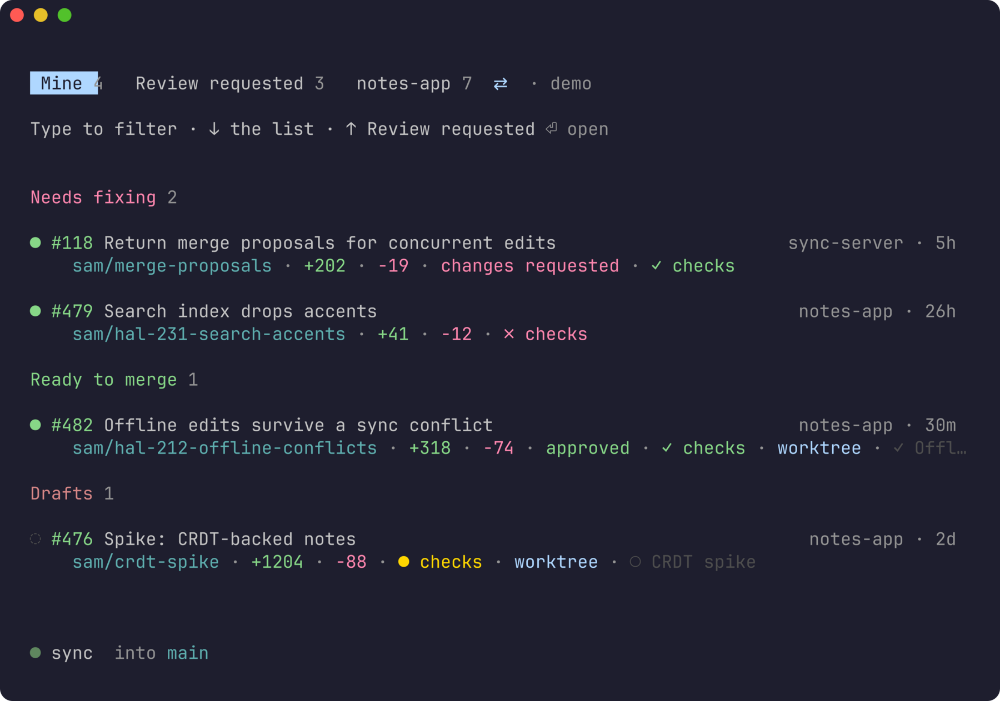
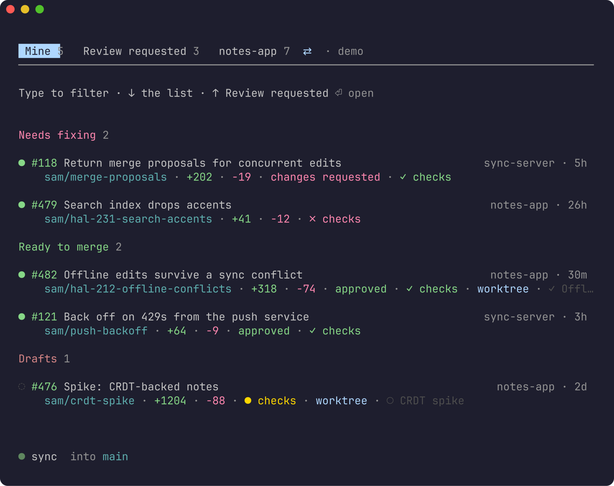
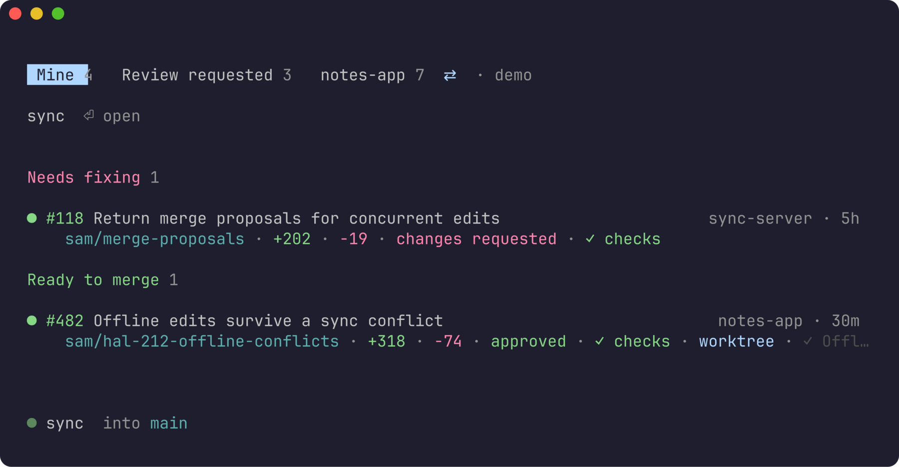
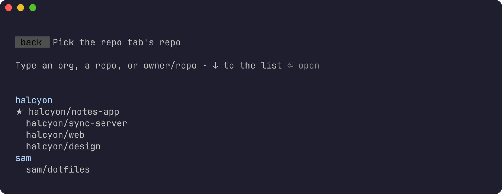
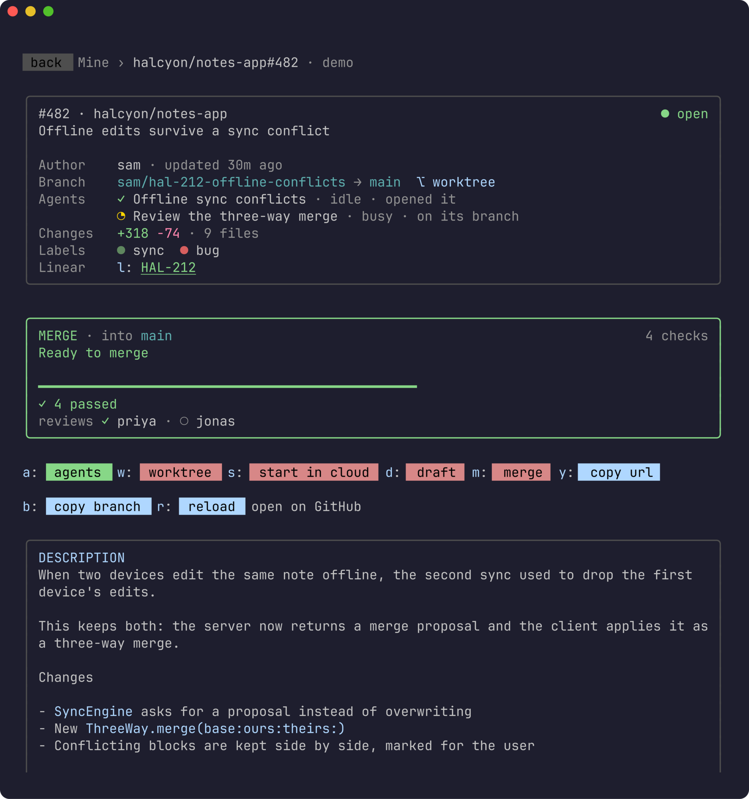
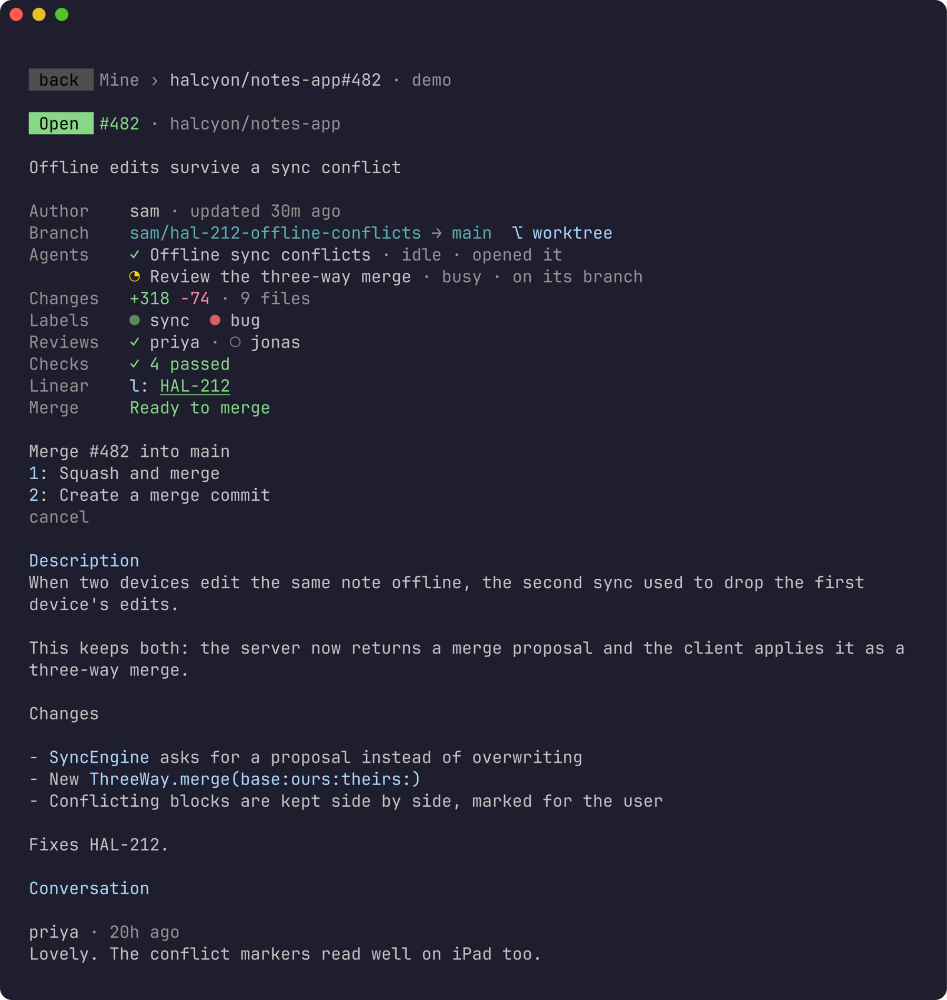
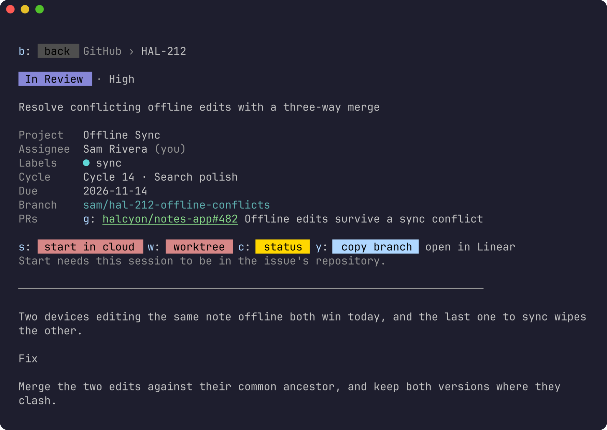

# claude-mods-github

**Your GitHub pull requests in a pane beside Claude Code.** See what's waiting
on you, read a PR with its checks and reviews, flip it between draft and
ready, merge it, and put a Claude Code cloud session on it, without leaving
the conversation.



- **Three tabs**: *Mine* (your open PRs, every repo), *Review requested*,
  and *this repo* (every open PR in the session's repository, or another you
  pick), each **grouped by whose move it is**: what needs fixing, what's
  ready to merge, what's waiting, your drafts. Under each PR's title: its
  branch, its size, its review, its checks, auto-merge, its worktree and its
  sessions.
- **A PR's screen**, laid out as
  [herdr-github](https://github.com/mrolafsson/herdr-github)'s: merge
  readiness in one line (and why not), checks that need attention,
  reviewers, the description as Markdown, unresolved review threads, and the
  conversation.
- **Draft ↔ ready** with one key.
- **Merge** with any method the repo allows, your last one first, after a
  confirmation pinned to the commit you were looking at. Not mergeable yet?
  **Auto-merge** instead. Then, if you like, delete the branch and remove the
  worktree.
- **Start in cloud**: a Claude Code cloud session on the PR, told to check
  out its branch, read the review threads and the failing checks, and push
  to it.
- **Worktrees**: one key finds or makes a git worktree on the PR's branch,
  beside your checkout. Forks included.
- **Its sessions**: the Claude Code sessions that opened the PR, worked on its
  branch or were started on it, a key away.
- **Works with [claude-mods-linear](https://github.com/mrolafsson/claude-mods-linear)**:
  a PR's Linear issue opens in the Linear pane, an issue's PRs open here,
  and Esc comes back.
- **Try it without an account**: `/github demo` is a made-up org.
- Uses **gh's sign-in**: no tokens of its own, GitHub Enterprise included.

A Claude Code mod: a plugin that draws in Claude Code's own interface, in a
terminal session. It's a separate, smaller thing from herdr-github, the herdr
plugin it takes its look from: they share no code, and it needs no herdr.

**Contents:** [Requirements](#requirements) · [Install](#install) ·
[Try it without an account](#try-it-without-an-account) · [Use](#use) ·
[Merging](#merging) · [Start in cloud](#start-in-cloud) ·
[Worktrees](#worktrees) · [Its sessions](#its-sessions) ·
[With the Linear mod](#with-the-linear-mod) · [Where it opens](#where-it-opens) ·
[Privacy and security](#privacy-and-security) · [Development](#development) ·
[License](#license)

## Requirements

- [Claude Code](https://claude.com/claude-code) in a terminal. The pane draws
  there; the iPhone and iPad apps don't show mod panes, and a `/github` typed
  there arrives as text.
- **[gh](https://cli.github.com)**, signed in (`gh auth login`). The pane
  asks GitHub through it.
- **git**, for worktrees.
- For **Start in cloud**: `claude --cloud` working where you run Claude (a
  Claude account with cloud sessions), and `script`, which macOS and Linux
  have.

## Install

At the prompt of a Claude Code session:

```
/plugin install github --marketplace mrolafsson/claude-mods-github
```

Answer `y` to add the marketplace, then pick a scope: **user**, for every
session. Or from a shell:

```sh
claude plugin install github --marketplace mrolafsson/claude-mods-github
```

`/plugin update` brings a newer version.

## Try it without an account

`/github demo` opens the pane on *Halcyon*, a made-up notes-app company with
four repos and a handful of PRs (the same company as the Linear mod's demo).
Everything works: drafts flip, PRs merge, auto-merge turns on. Nothing is
real: the demo never runs gh or git and starts no session; it says what the
real thing would have done. `/github` goes back to your own.

It's also how the screenshots in this README are made. See
[Screenshots](#screenshots).

## Use

### The lists

Type `/github`. The pane opens on the tab you left, the cursor in the filter.

| tab | shows |
| --- | --- |
| **Mine** | your open PRs across every repo |
| **Review requested** | open PRs asking for your review (or your team's) |
| **this repo** | every open PR in the session's repository; **⇄** beside it picks another |

**↑** from the filter switches tab: Mine, Review requested, the repo, its
**⇄**, and round again. Every tab is grouped by whose move it is, newest
first within each group:

| group | is |
| --- | --- |
| **To review** | (*Review requested* only) asked of you, and nothing wrong with it |
| **Needs fixing** | checks failed, in conflict, or changes requested |
| **Ready to merge** | approved; or no review asked of it and its checks passed |
| **Waiting** | on its reviewers, or on checks still running |
| **Drafts** | not out for review yet |



A PR is two lines: its state (`●` open, `◌` draft), number and title, and at
the right edge whose it is, its repo and when it last changed, each only
where the tab doesn't already say. Under it: its branch, lines added and
removed, `conflicts`, `changes requested` or `approved`, its checks (`✓`
passed, `✗` failed, `●` running), `auto-merge`, `worktree` if one exists,
and the first of its sessions. The line under the list has the selected PR's
labels and the branch it's to be merged into.

Type to filter: every word must match the number, title, repo, author,
branch or a label.



**↓** goes into the list; **↑ ↓** move through it and **Enter** opens a PR.
**Enter** in the filter opens the first match. The list draws what fits and
follows you through it, saying how many more are above and below. A list
shows what was found last time at once, marked *updating…*, while GitHub is
asked again.

### Another repo

**⇄** beside the repo tab (a click, or **↑** onto it and **Enter**) lists the
repos you can reach, **grouped by organisation**, the session's org first
with its repo on top, then your recent picks and every other repo you can
reach on GitHub. Type to narrow it down; an org's name keeps its whole
group, and any `owner/repo` typed whole can be used even if it isn't listed.



### A PR



Its state, then what matters before merging: author, branch and its
worktree, its sessions, the size, labels, reviewers (`✓` approved, `✗`
changes requested, `○` asked), checks, its Linear issue, and merge readiness
in one line. Below: the checks that need attention, the description, the
unresolved review threads and the conversation.

The screen is taller than the pane, so the arrows scroll it, and the letters
act:

| key | does |
| --- | --- |
| **a** | its sessions |
| **w** | its worktree |
| **s** | start in cloud |
| **d** | draft ↔ ready |
| **m** | merge |
| **y** / **b** | copy its link / its branch |
| **r** | reload |
| **l** | its Linear issue, with the Linear mod |
| Esc | back to the list (or to the pane it was opened from) |

**open on GitHub** is a link.

### All keys

| key | does |
| --- | --- |
| type | filter; Enter opens the first match |
| ↓ | from the filter into the list |
| ↑ ↓, Enter | through the list; open the PR |
| ↑ from the filter | the next tab, then the repo tab's ⇄ |
| a w s d m y b r l | on a PR, as above |
| 1–9 | in a menu: that option |
| Esc | close a menu; back from a PR; clear the filter; close |

The mouse works too: a click opens a row, a tab or a link.

## Merging

**m** lists what the PR can do now:



- **Mergeable now**: every method the repo allows, the one you used last in
  that repo first (otherwise GitHub's default for you).
- **Not yet** (reviews or checks outstanding): **Auto-merge when ready**,
  where the repo allows it, with the method that would be used. **Turn off
  auto-merge** if it's on.
- **Can't**: why, in a line (a draft, conflicts, closed, no permission).

A pick asks once more, naming exactly what happens (*Squash and merge #482
into main now?*). The merge is pinned to the commit the screen showed: if
someone pushed since, GitHub refuses, and the pane says so, to reload and look
again. After a merge it offers to delete the branch on GitHub (unless the repo
does that itself) and to remove the PR's worktree, refusing if it holds
uncommitted changes.

## Start in cloud

**s** on a PR, or **start in cloud**, starts a Claude Code cloud session on
it, as the Linear mod's Start does for an issue. It's told the PR's link and
title, to check it out with `gh pr checkout` and push to its branch, to read
the conversation, the failing checks and the unresolved review threads, and
to say what's left to do.

It starts from a checkout of the PR's repo on this computer (the cloud clones
the repo from GitHub; the checkout only says which): the session's own
repository, the folder of a running session in it, one used before, or
`~/code/owner/repo`. With none, the pane offers to clone it there first.

The pane shows the session's link, and the session is kept with the PR among
[its sessions](#its-sessions); it's in your sessions at claude.ai/code and in
the Claude app too.

## Worktrees

**w** finds the PR's worktree, or makes one: a git worktree on the PR's
branch, beside your checkout of the repo, at `<repo>.worktrees/<branch>`. A
fork's PR is checked out with `gh pr checkout`, so it pushes back to the fork.
The pane shows the path and a `cd … && claude` to copy (**c**). It starts
nothing: it's the local way to work on a PR, as Start is the cloud way.

## Its sessions

**a** lists the Claude Code sessions that have to do with the PR, also shown
on its screen and, the first of them, under its title in the list:

- **running now** in a folder on the PR's branch;
- **past sessions** whose transcripts in the last 30 days name the PR,
  including the one that opened it with `gh pr create`;
- **cloud sessions** Start began on it.

A pick copies the command that takes you back to it (`claude --resume …` or
`claude attach …`), or opens a cloud session's page.

## With the Linear mod

With [claude-mods-linear](https://github.com/mrolafsson/claude-mods-linear)
installed too, the two find each other, with nothing to configure:

- A PR's screen names its **Linear issue**, from its branch or title
  (`sam/hal-212-…` is HAL-212). **l** opens it in the Linear pane.
- A Linear issue's screen lists its **pull requests**, from Linear's own
  links to GitHub. **g** (or a click) opens one here.
- **Esc** in the pane you went to comes back to the one you came from, as you
  left it.
- In a terminal too narrow for Claude Code to draw the other pane (it holds
  back a pane a mod opens by itself under 110 columns, which a jump by Esc
  is), the command is put in the prompt instead: Enter opens it. A draft
  you're typing is left alone.



Without the other mod, the same key is shown as plain text, and nothing
links.

## Where it opens

Claude Code decides where a pane goes, by your renderer:

- `/tui fullscreen`: docked beside the conversation, up to 45% of the width.
- `/tui default`: above the prompt, as tall as the layout spares.

The pane asks for all the room it can get, and a size you drag it to wins.

## Privacy and security

- GitHub is asked through `gh api graphql`, with gh's own sign-in. The pane
  keeps no token.
- It runs `gh`, `git` (for worktrees, and to find checkouts by their
  remotes), `claude agents --json` (the running sessions), `claude --cloud`
  through `script` (only when you press **start in cloud**), and a search
  of your own transcripts in `~/.claude/projects` for the PRs' links, on
  this computer.
- What it keeps, in Claude Code's plugin store on this computer
  (`~/.claude/plugins/store/`): the lists as last loaded, your repos, recent
  picks, the merge method you used last per repo, where each repo's checkout
  is, and the links of cloud sessions it started.
- Merging, auto-merge, draft ↔ ready and deleting a branch each ask first or
  happen only on their own key; removing a worktree refuses if it holds
  changes.
- The demo contacts nothing and runs nothing.

## Development

From a checkout, start Claude Code with the mod loaded from it:

```sh
claude --plugin-dir .
```

Run the tests, which drive the pane against a stand-in gh, git and claude:

```sh
claude plugin test .
claude plugin validate .
```

### Screenshots

```sh
sh scripts/screenshots.sh           # rewrites docs/images/
```

Starts Claude Code with the mod (and the Linear mod, from
`../claude-mods-linear` or `$LINEAR_MOD`) in a hidden tmux window, opens
`/github demo`, walks through the screens with key presses and captures each
one; `scripts/crop-pane.py` cuts the pane out, and
[freeze](https://github.com/charmbracelet/freeze) draws it. Only the demo's
made-up data is ever in a picture, and `/github` runs in the mod: nothing
reaches the model. Needs tmux, freeze, rsvg-convert with the JetBrains Mono
font, and python3.

## License

MIT
